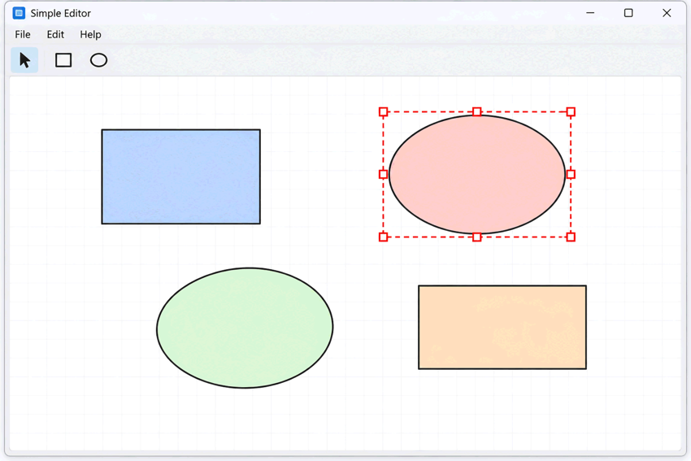
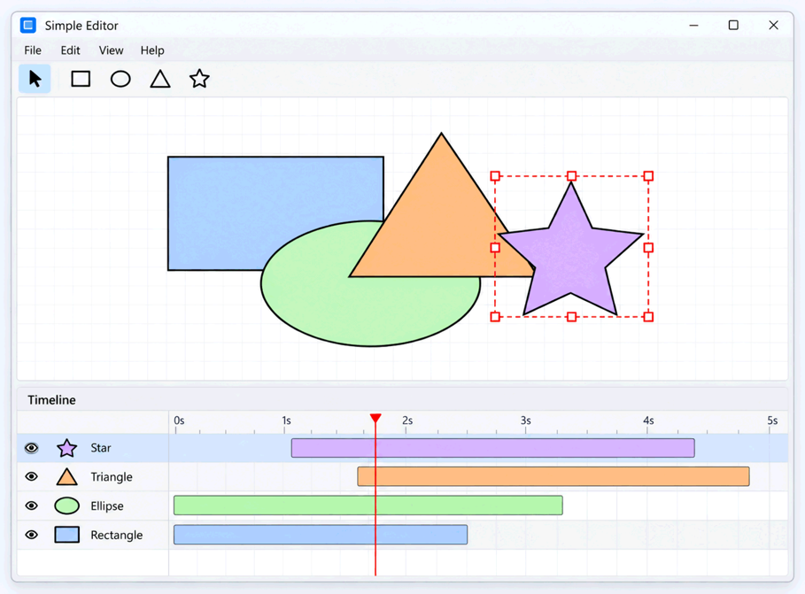

# Лабораторная работа №4. Undo/Redo в графическом редакторе

- [Лабораторная работа №4. Undo/Redo в графическом редакторе](#лабораторная-работа-4-undoredo-в-графическом-редакторе)
  - [Цель работы](#цель-работы)
  - [Критерии оценивания лабораторной работы](#критерии-оценивания-лабораторной-работы)
  - [Реализация механизма Undo/Redo — **100 баллов**](#реализация-механизма-undoredo--100-баллов)
    - [Добавление и удаление фигур](#добавление-и-удаление-фигур)
    - [Перемещение фигур](#перемещение-фигур)
    - [Изменение размеров фигур](#изменение-размеров-фигур)
    - [Preview и Commit](#preview-и-commit)
    - [Undo и Redo](#undo-и-redo)
    - [Гранулярность истории](#гранулярность-истории)
    - [Загрузка и сохранение документа](#загрузка-и-сохранение-документа)
    - [Избавьтесь от `dynamic_cast`](#избавьтесь-от-dynamic_cast)
    - [Требования к архитектуре](#требования-к-архитектуре)
    - [Автоматические тесты](#автоматические-тесты)
    - [Бонусные задания](#бонусные-задания)
      - [Бонус: изменение цвета фигур — **+10 баллов**](#бонус-изменение-цвета-фигур--10-баллов)
      - [Бонус: создание фигур мышью — **+20 баллов**](#бонус-создание-фигур-мышью--20-баллов)
      - [Бонус: множественное выделение — **+30 баллов**](#бонус-множественное-выделение--30-баллов)
      - [Бонус: `TimelineView` — **+100 баллов**](#бонус-timelineview--100-баллов)
      - [Бонус: несколько окон для одного документа — **+20 баллов**](#бонус-несколько-окон-для-одного-документа--20-баллов)
      - [Бонус: масштабирование Canvas — **+20 баллов**](#бонус-масштабирование-canvas--20-баллов)
      - [Бонус: масштабирование Timeline — **+20 баллов**](#бонус-масштабирование-timeline--20-баллов)
      - [Бонус: многодокументное редактирование — **30 баллов**](#бонус-многодокументное-редактирование--30-баллов)
      - [Совместная работа бонусов](#совместная-работа-бонусов)

## Цель работы

Развить графический редактор, созданный в лабораторной работе №3,
добавив в него поддержку отмены и повторного выполнения пользовательских действий.

В ходе работы необходимо отделить незавершённое взаимодействие пользователя с редактором от
зафиксированных изменений документа и организовать историю редактирования так,
чтобы новые обратимые операции можно было добавлять без изменения общего механизма Undo/Redo.

---

## Критерии оценивания лабораторной работы

При сдаче лабораторной работы студент должен уметь ответить
на вопросы преподавателя насчёт используемых паттернов проектирования,
уметь изобразить схему паттерна на диаграмме классов,
а также **продемонстрировать диаграмму классов своего приложения**.

- На оценку «удовлетворительно» необходимо набрать 160 баллов.
- На оценку «хорошо» необходимо набрать 240 баллов.
- На оценку «отлично» необходимо набрать 320 баллов.

## Реализация механизма Undo/Redo — **100 баллов**

Возьмите за основу графический редактор, разработанный в лабораторной работе №3.



Вся обязательная функциональность лабораторной работы №3 должна сохраниться.
В частности, приложение должно по-прежнему уметь создавать, загружать, сохранять и отображать документы,
выбирать фигуры и выполнять предусмотренные предыдущей работой операции редактирования.

Расширьте редактор следующими возможностями:

- добавление фигур;
- удаление фигур;
- перемещение фигур мышью;
- изменение размеров фигур мышью;
- Undo;
- Redo.

Все перечисленные операции, изменяющие документ, должны поддерживать Undo и Redo.

Способ добавления фигуры в основной части задания может остаться таким же, каким он был в лабораторной работе №3.
Создание фигуры непосредственным протягиванием мыши по Canvas является отдельным бонусным заданием.

---

### Добавление и удаление фигур

Пользователь должен иметь возможность добавить новую фигуру в документ и удалить выбранную фигуру.

Добавление одной фигуры считается одной операцией редактирования:

```text
Add
 ↓
Undo
 ↓
фигура исчезает
 ↓
Redo
 ↓
фигура появляется снова
```

Аналогично, удаление одной фигуры должно отменяться и повторяться как одна операция.

После Undo удаления фигура должна восстанавливаться в том же состоянии и в том же месте среди остальных фигур,
в котором она находилась до удаления.

После удаления фигуры в приложении не должно оставаться невалидных ссылок на неё, в том числе в состоянии выделения.

**Должно поддерживаться не менее 5 различных видов фигур**.

---

### Перемещение фигур

Выбранную фигуру можно перемещать при помощи мыши.

Одно перемещение от нажатия кнопки мыши до её отпускания считается **одним пользовательским действием**
независимо от числа событий перемещения мыши:

```text
MousePressed
MouseMoved
MouseMoved
MouseMoved
...
MouseReleased
        ↓
одна операция в истории
```

Во время перемещения приложение должно отображать промежуточное положение фигуры.

Undo должен восстанавливать положение фигуры до начала drag, а Redo — положение после его завершения.

Если положение фигуры фактически не изменилось, новая операция в истории создаваться не должна.

---

### Изменение размеров фигур

Для выбранной фигуры должна быть предусмотрена возможность изменить её размеры мышью.
Конкретное визуальное представление элементов resize — например, маркеры на рамке выделения — выбирается самостоятельно.

Во время resize пользователь должен видеть промежуточный результат.

Вся операция от начала resize до её завершения должна попадать в историю как **одно действие**.

Undo должен восстанавливать размеры и положение фигуры до начала операции, а Redo — повторно применять итоговый размер.

Фигура не должна в результате resize приобретать недопустимые размеры.

---

### Preview и Commit

Событие GUI не обязательно является отдельным пользовательским действием.

Во время drag или resize может происходить множество промежуточных обновлений:

```text
Begin
 ↓
Update
 ↓
Update
 ↓
Update
 ↓
Commit
```

В историю должно попадать только завершённое действие.

Промежуточное состояние, которое пользователь видит во время операции,
не обязано немедленно становиться зафиксированным состоянием документа.

Архитектура должна позволять прервать незавершённую операцию без появления лишних записей в Undo/Redo-истории.

---

### Undo и Redo

Реализуйте отмену и повторное выполнение операций редактирования.

Рекомендую ознакомиться с [примером](../../samples/vector-editor/gfx_editor/08_undo/),
иллюстрирующим реализацию базовых возможностей Undo/Redo.

Для приложения должны быть предусмотрены горячие клавиши:

| Действие | Горячая клавиша |
|---|---|
| Undo | `Ctrl+Z` |
| Redo | `Ctrl+Y` или `Ctrl+Shift+Z` |

Допускается использовать другие комбинации клавиш, если это соответствует соглашениям выбранной платформы.

История должна вести себя следующим образом:

```text
A → B → C
        ↑
       Undo

A → B

затем выполняется новое действие D

A → B → D
```

После выполнения `D` действие `C` больше не должно быть доступно через Redo.

Повторный вызов Undo в начале истории и Redo в её конце не должен приводить к ошибке.

Действия, которые фактически не изменили документ, не должны засорять историю.

---

### Гранулярность истории

История должна хранить **пользовательские действия**, а не низкоуровневые события интерфейса.

Минимально должны выполняться следующие правила:

| Действие пользователя | Число операций в истории |
|---|---:|
| Добавить одну фигуру | 1 |
| Удалить одну фигуру | 1 |
| Один drag перемещения | 1 |
| Один drag resize | 1 |

Не допускается создание отдельной команды для каждого `MouseMoved`.

---

### Загрузка и сохранение документа

Функциональность загрузки и сохранения, реализованная в лабораторной работе №3, должна сохраниться.

В файл должно сохраняться **состояние документа**, но не история его редактирования.

После открытия документа:

- загруженное состояние становится начальным состоянием документа;
- Undo/Redo-история должна быть пустой;
- последующие изменения должны попадать в новую историю.

Операция сохранения не должна создавать запись в Undo/Redo-истории и не должна очищать существующую историю.

Сохраняться должно только зафиксированное состояние документа.
Временное состояние незавершённого drag/resize, выделение фигур,
масштаб View и другое состояние интерфейса не должны случайно попадать в файл.

Если в рамках бонусных заданий у фигур появятся новые свойства, являющиеся частью документа,
например цвет или временной интервал, они также должны корректно сохраняться и загружаться.

---

### Избавьтесь от `dynamic_cast`

В лабораторной работе №3 для определения конкретного типа фигуры мог использоваться `dynamic_cast`.
В этой работе такой способ диспетчеризации необходимо заменить.

Типоспецифичные операции, например Rendering и Serialization,
не должны определять тип фигуры при помощи цепочек `dynamic_cast`, `typeid` или аналогичных ручных проверок типа.

Для C++ используйте **double dispatch** и Visitor:

```cpp
class IShape
{
public:
    virtual void Accept(IShapeVisitor& visitor) const = 0;

    // ...
};
```

Конкретные операции должны реализовывать соответствующий Visitor.

Обычные полиморфные операции фигур, такие как `GetBounds`, `HitTest`,
перемещение или изменение размера, не требуется искусственно переносить в Visitor.

При выполнении лабораторной работы на другом языке программирования используйте идиоматичный
для выбранного языка механизм диспетчеризации, позволяющий избежать ручного определения динамического типа объекта.

---

### Требования к архитектуре

История изменений должна быть отдельной ответственностью и не должна находиться внутри View.

Операции, сохраняемые в истории, должны содержать достаточно информации,
чтобы выполнить и отменить соответствующее изменение документа.

Для C++ естественным вариантом является интерфейс наподобие:

```cpp
class ICommand
{
public:
    virtual ~ICommand() = default;

    virtual void Execute() = 0;
    virtual void Unexecute() = 0;
};
```

Конкретные имена классов, устройство истории и структура слоёв редактора выбираются самостоятельно.
Воспроизводить архитектуру из лекции буквально не требуется.

При проектировании обращайте внимание на следующие вопросы:

- кому принадлежит Undo/Redo-история;
- как связан её жизненный цикл с жизненным циклом документа;
- где хранится состояние незавершённого interaction;
- кто формирует завершённую команду;
- какие объекты должны знать о механизме Undo/Redo;
- каким образом View узнают об изменении документа после Execute, Undo и Redo.

Не создавайте специальных путей обновления интерфейса только для Undo или Redo,
если того же результата можно добиться через обычный механизм распространения изменений модели.

---

### Автоматические тесты

Логику Undo/Redo, не зависящую от GUI, необходимо покрыть автоматическими тестами.

В частности, следует проверить:

- последовательное Undo нескольких операций;
- последовательное Redo;
- невозможность Redo после выполнения нового действия вслед за Undo;
- корректное восстановление состояния после Add/Delete;
- корректное восстановление положения после Move;
- корректное восстановление состояния после Resize;
- корректное поведение на границах истории;
- сохранение порядка фигур после Delete → Undo;
- отсутствие регрессий в загрузке и сохранении документа.

GUI не обязательно полностью покрывать автоматическими тестами,
однако значимая логика редактирования не должна быть доступна для проверки только через ручное взаимодействие с окном.

---

### Бонусные задания

Бонусы оцениваются независимо. Получение баллов за один бонус не требует реализации остальных, кроме явно указанных зависимостей.

Функциональность, добавленная в рамках бонуса и изменяющая состояние документа, также должна корректно работать с Undo/Redo.

#### Бонус: изменение цвета фигур — **+10 баллов**

Добавьте возможность изменять внешний вид выбранной фигуры.

Пользователь должен независимо задавать:

- цвет заливки;
- цвет обводки.

Изменение цвета должно быть обратимой операцией.

Если реализовано множественное выделение, изменение цвета применяется
ко всем выбранным фигурам как одна пользовательская операция.

Цвет является частью документа и должен сохраняться в файл.

---

#### Бонус: создание фигур мышью — **+20 баллов**

Добавьте инструменты создания фигур непосредственно на Canvas.

Пользователь выбирает тип фигуры на панели инструментов, нажимает кнопку мыши в начальной точке,
перемещает курсор с зажатой кнопкой и отпускает кнопку в конечной точке.

Во время drag должен отображаться Preview создаваемой фигуры.

После отпускания мыши должна появиться одна фигура, положение и размеры которой определяются начальной и конечной точками.

Вся операция создания должна попадать в историю как одна команда.

Если итоговая ширина или высота равна нулю, фигура не должна создаваться, а история не должна изменяться.

---

#### Бонус: множественное выделение — **+30 баллов**

Добавьте возможность одновременно выделять несколько фигур.

Способ добавления и удаления фигур из выделения выбирается самостоятельно;
рекомендуется использовать привычные модификаторы клавиатуры вроде `Ctrl` или `Shift`.

Для множественного выделения должны поддерживаться как минимум:

- совместное перемещение;
- удаление всех выбранных фигур.

Перемещение нескольких фигур за один drag считается одной операцией и отменяется одним Undo.

Удаление нескольких выделенных фигур также считается одной операцией и должно полностью восстанавливаться одним Undo.

Относительное расположение фигур при совместном перемещении должно сохраняться.

Групповой resize в рамках данного бонуса не требуется.

---

#### Бонус: `TimelineView` — **+100 баллов**

Добавьте в окно редактора второе представление документа — `TimelineView`.



Timeline должен позволять:

- видеть фигуры документа;
- выбирать фигуру;
- выбирать текущий момент времени (перемещение фигуры по горизонтали).
- изменять слои выделенных фигур (перемещение выделенных слоёв по вертикали)

Выделение в Canvas и Timeline одного окна должно быть синхронизировано:

```text
выделили фигуру на Canvas
          ↓
она выделена на Timeline

выделили фигуру на Timeline
          ↓
она выделена на Canvas
```

Canvas и Timeline должны использовать общее состояние редактирования окна,
а не поддерживать независимые копии selection.

Изменение текущего момента времени относится к состоянию окна и не должно попадать в Undo/Redo-историю документа.

Если временная модель редактора предполагает редактирование свойств фигур на Timeline,
такие изменения документа должны выполняться через Undo/Redo на общих основаниях.

---

#### Бонус: несколько окон для одного документа — **+20 баллов**

Добавьте возможность открыть дополнительное окно для уже открытого документа.
Например, для этого можно предусмотреть отдельную горячую клавишу или пункт меню.

Окна одного документа должны совместно использовать:

- одно состояние документа;
- одну Undo/Redo-историю.

При этом состояние конкретного окна должно оставаться независимым.
В частности, разные окна могут иметь разные selection и эффективное состояние Preview.

Committed-изменение, выполненное в одном окне, должно автоматически отображаться во всех остальных окнах того же документа.

Undo или Redo можно вызвать из любого окна. Операция изменяет общий документ.

После Undo/Redo выделение **в активном окне** должно переключаться на фигуру или фигуры,
к которым относилась отменённая либо повторённая операция.

Selection остальных окон не следует без необходимости менять.
Если выбранная в другом окне фигура перестала существовать,
окно обязано корректно обработать эту ситуацию и не хранить невалидную ссылку.

Если одновременно реализован `TimelineView`,
разные окна одного документа должны иметь возможность выбирать **разные текущие моменты времени**.

---

#### Бонус: масштабирование Canvas — **+20 баллов**

Добавьте возможность увеличивать и уменьшать масштаб Canvas например, при помощи клавиатуры,
 `Ctrl+Mouse Wheel` или кнопок управления масштабом.

Масштаб относится к View и:

- не является состоянием документа;
- не попадает в Undo/Redo;
- не сохраняется как часть Drawing.

Если реализована многооконность, каждое окно должно иметь собственный масштаб Canvas.

---

#### Бонус: масштабирование Timeline — **+20 баллов**

При реализованном `TimelineView` добавьте возможность управлять масштабом временной шкалы.

Масштаб Timeline относится к конкретному View.

При работе одного документа в нескольких окнах каждое окно должно иметь возможность использовать собственный масштаб Timeline.

---

#### Бонус: многодокументное редактирование — **30 баллов**

Добавьте возможность одновременно работать с несколькими документами.

Создание нового документа и открытие существующего документа должны создавать отдельный
редактируемый документ со своей историей изменений.

Каждый документ должен иметь: собственное состояние + собственную Undo/Redo-историю.

Undo в одном документе не должен влиять на другой.

Этот бонус не должен конфликтовать с возможностью открыть **один документ в нескольких окнах**.

Например, приложение может находиться в следующем состоянии:

```text
Document A
├── Window A1
├── Window A2
└── History A

Document B
├── Window B1
└── History B
```

Окна `A1` и `A2` разделяют документ и историю, но не разделяют их с окном `B1`.

Документ должен существовать до тех пор, пока открыто хотя бы одно связанное с ним окно.
После закрытия последнего окна документ и его история должны быть уничтожены.

---

#### Совместная работа бонусов

Если реализовано несколько бонусных возможностей, они должны корректно работать вместе.

В частности:

```text
Multiple selection + Delete
→ все выбранные фигуры удаляются одной операцией

Multiple selection + Color
→ цвет всех выбранных фигур меняется одной операцией

Timeline + Multiple windows
→ в разных окнах можно выбрать разные моменты времени

Canvas zoom + Multiple windows
→ каждое окно имеет свой масштаб Canvas

Timeline zoom + Multiple windows
→ каждое окно имеет свой масштаб Timeline

Multiple documents + Multiple windows
→ окна одного документа разделяют историю,
  разные документы имеют разные истории
```

Реализация бонуса не должна нарушать обязательную функциональность или уже реализованные бонусы.
